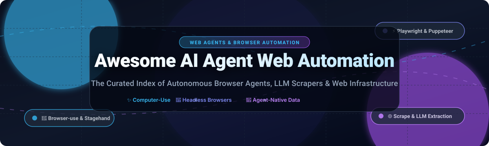

  

# 🌐 Awesome AI Agent Web Automation 🤖

  
  
  
  
  
  
  

---

## 🚀 Top AI Agent Web Automation Platforms & Open-Source Ecosystem

> **A curated collection of leading SaaS platforms, frameworks, computer-use agents, and open-source libraries for autonomous web browsing, AI web scraping, and agentic web access.**

*Keywords: AI Agents, Web Automation, Browser Agents, Web Scraping, Computer Use, LLM Web Grounding, Headless Browser, Playwright, Puppeteer, Crawl4AI, Browser-use.*

**📅 Last updated: October 2026**

This repository tracks notable **SaaS platforms** and **open-source projects** for **AI Agent Web Automation**. These tools empower AI agents to autonomously navigate websites, scrape dynamic content, bypass anti-bot mechanisms, fill forms, execute multi-step workflows, and convert unstructured DOM elements into clean, LLM-ready markdown and JSON.

---

## 📑 Table of Contents
- [📊 Sector Overview & Market Dynamics](#-sector-overview--market-dynamics)
- [🏢 SaaS/Hosted Platforms](#-saashosted-platforms)
- [💻 Open-Source GitHub Projects](#-open-source-github-projects)
- [📈 Star History](#-star-history)
- [🤝 How to Contribute](#-how-to-contribute)
- [💖 Support](#-support)
- [⚖️ Disclaimer](#-disclaimer)

---

## 📊 Sector Overview & Market Dynamics

The global web scraping and automated data extraction software market is estimated at approximately **$1.3B to $1.6B** (projected to reach over $3B+ by 2030, accelerated by exponential demand for real-time web grounding, enterprise RAG pipelines, and autonomous agent web navigation). The sector is **moderately fragmented**—while high-barrier residential proxy networks, browser fingerprint spoofing, and enterprise CAPTCHA solving are concentrated around top infrastructure titans (such as Oxylabs and Bright Data), a vibrant ecosystem of specialized visual scrapers, cloud actor marketplaces, and developer-centric APIs prevents winner-take-all dynamics.

---

## 🏢 SaaS/Hosted Platforms

| Platform | Estimated Scale / Valuation | Pricing (Starting Paid Tier) | Free Tier / Trial Limits | Description |
| :--- | :--- | :--- | :--- | :--- |
| **[Oxylabs](https://oxylabs.io/)** | **$3.6B Valuation** (~$350M ARR) | $30/month (Starter residential proxy plan, includes 5 GB) | $5 welcome credit on signup (no credit card required) or 7-day managed trial for verified businesses | Premium proxy and web scraping infrastructure provider with APIs and tools for reliable data gathering at scale. |
| **[Bright Data](https://brightdata.com/)** | **$1B+ Valuation** (~$300M+ ARR) | $14/month (Datacenter proxy starter) / $499/month (Growth scraping API commitment) | 5,000 free credits/month recurring (for Web Unlocker/SERP/Scraper APIs, ~1 GB browser traffic) + $5 one-time proxy test credit | Enterprise web data platform offering proxies, scraping APIs, and browser infrastructure for large-scale collection and agent access. |
| **[Zyte](https://www.zyte.com/)** | **~$25M ARR** (Scrapinghub) | $9/month (Scrapy Cloud basic unit) / Pay-As-You-Go API starting at $0.13 per 1,000 HTTP requests | 30-day free trial with $5 free credit upon registration (hard cap, no card required) | Web scraping platform offering Smart Proxy Manager, automatic extraction, Scrapy Cloud, and managed crawling services. |
| **[Octoparse](https://www.octoparse.com/)** | **~$15M - $20M Revenue** | $89/month ($69/month billed annually for Standard Plan with 100 tasks & cloud extraction) | Free Forever Plan: 10 local tasks, up to 10,000 records per export, 50,000 records/month (local execution only) | No-code / low-code web scraping tool popular for turning websites into structured data without heavy programming. |
| **[Apify](https://apify.com/)** | **~$13M - $15M ARR** (€2.8M Series A) | $49/month (Starter plan with $49 prepaid usage, 32 GB RAM, 30-day retention) | Free Forever Plan: $5/month prepaid platform credits, 16 GB max RAM, 5 datacenter proxies, no credit card required | Full-stack web scraping and automation platform with Actors, browser farms, and APIs widely used by developers and AI agents. |
| **[Import.io](https://www.import.io/)** | **~$50M - $100M Valuation** ($38M funded; Acquired) | $199/month (Standard plan billed annually for 50,000 queries/month) | 30-day free trial with 5,000 successful queries included (no credit card required, hard cap) | Web data integration platform focused on converting web content into structured datasets for enterprise use. |
| **[ParseHub](https://www.parsehub.com/)** | **~$5M - $10M Revenue** | $189/month (Standard plan with 10,000 pages per run & 20 private projects) | Free Forever Plan: 5 public projects, 200 pages scraped per run, 14-day data retention | Visual web scraping tool that lets users build scrapers through a point-and-click desktop interface. |
| **[Browse AI](https://www.browse.ai/)** | **~$2.8M Funded** (~$2M - $4.5M ARR) | $48/month ($19/month billed annually for Personal Plan with 2,000 credits/month) | Free Forever Plan: 50 credits/month, 2 websites monitored, up to 500 rows/month extracted | No-code web automation and monitoring platform that trains robots to extract and monitor website data. |
| **[Crawlbase](https://crawlbase.com/)** | **Bootstrapped / Seed** (~$2M - $5M ARR) | $99/month (Starter subscription block with 200,000 requests) or Pay-As-You-Go ($0/mo commitment) | Free Trial: 5,000 free successful API requests upon registration and onboarding (no credit card required) | Web scraping API and crawling platform designed for developers who need clean HTML/JSON from complex sites. |

---

## 💻 Open-Source GitHub Projects

*Sorted in descending order by GitHub Stars ⭐.*

- **[Firecrawl](https://github.com/mendableai/firecrawl)**   
  Turn entire websites into LLM-ready markdown or structured data with clean API endpoints, crawl orchestration, and anti-bot bypassing.

- **[Browser-use](https://github.com/browser-use/browser-use)**   
  Leading open-source library that makes websites accessible to AI agents through browser automation (navigation, clicking, typing, and form filling) on local or remote browsers.

- **[Playwright](https://github.com/microsoft/playwright)**   
  High-reliability cross-browser automation library from Microsoft (Chromium, Firefox, WebKit) serving as the foundational driver for modern agentic web tools and MCP servers.

- **[Agent-Reach](https://github.com/Panniantong/Agent-Reach)**   
  Capability layer and technical architecture for widespread agent deployment and web access—selects, installs, health-checks, and routes upstream tools so agents can reach the web with minimal API overhead.

- **[Puppeteer](https://github.com/puppeteer/puppeteer)**   
  Node.js library providing a high-level API to control headless Chrome or Chromium, extensively used in web scraping, screenshot capture, and automated testing.

- **[Crawl4AI](https://github.com/unclecode/crawl4ai)**   
  Open-source, LLM-friendly web crawler that extracts clean Markdown, screenshots, and structured semantic data tailored specifically for AI agents and RAG pipelines.

- **[Open Interpreter](https://github.com/openinterpreter/openinterpreter)**   
  Natural language interface for computer-use agents capable of orchestrating web browsers, executing local terminal scripts, and interacting with desktop applications.

- **[Scrapy](https://github.com/scrapy/scrapy)**   
  Fast, industrial-strength open-source web crawling and web scraping framework for Python, serving as the trusted backbone for large-scale data harvesting.

- **[Selenium](https://github.com/SeleniumHQ/selenium)**   
  The classic browser automation framework supporting multiple languages and remote WebDriver grids, widely adapted for automated agent browsing tasks.

- **[GPT Researcher](https://github.com/assafelovic/gpt-researcher)**   
  Autonomous agent designed for comprehensive online web research, aggregating insights across dozens of web pages and scraping sources into detailed analytical reports.

- **[Crawlee](https://github.com/apify/crawlee)**   
  Scalable web scraping and browser automation library for Node.js and Python with built-in proxy rotation, request queues, anti-blocking safeguards, and session pools.

- **[Stagehand](https://github.com/browserbase/stagehand)**   
  AI-native web browsing automation framework built on Playwright that executes natural language instructions (`act`, `extract`, `observe`) for agentic workflows.

- **[Skyvern](https://github.com/Skyvern-AI/skyvern)**   
  Automates browser workflows using LLMs and computer vision to navigate complex websites, parse dynamic UI elements, and complete end-to-end forms without brittle XPath scripts.

- **[Claude Quickstarts (Computer Use)](https://github.com/anthropics/claude-quickstarts)**   
  Anthropic's official reference implementation for agent computer use, demonstrating autonomous mouse clicks, keystrokes, and web navigation via GUI control.

- **[Browserless](https://github.com/browserless/browserless)**   
  Dockerized browser automation service for running headless Chrome at scale, compatible with Puppeteer, Playwright, and web agent backends.

- **[Steel Browser](https://github.com/steel-dev/steel-browser)**   
  Open-source headless browser API designed specifically for AI agents, featuring built-in proxy management, fingerprint masking, and session persistence.

- **[LaVague](https://github.com/lavague-ai/LaVague)**   
  Large Action Model (LAM) framework for automating web tasks, converting natural language commands into robust browser automation actions using visual AI.

- **[WebArena](https://github.com/web-arena-x/webarena)**   
  Realistic and standardized benchmark environment for evaluating autonomous web agents across diverse tasks including e-commerce, content management, and forum interactions.

---

## 📈 Star History

---

## 🤝 How to Contribute

1. 🍴 Fork this repository.
2. 🌿 Create a new feature branch (`git checkout -b feature/new-entry`).
3. 📝 Add or update entries in `README.md` following the existing format.
4. 🔗 Include official documentation/homepage, GitHub link, accurate description, and open-source star badge or SaaS pricing.
5. 📬 Submit a Pull Request with a clear description of the addition!

---

## 💖 Support

If you find this repository valuable for your research, projects, or workflow:
- ⭐ **Star** this repository on GitHub to help others discover it!
- 🍴 **Fork** and share it with your AI & engineering community.
- ☕ **Sponsor & Buy a Coffee**: Support ongoing curation and maintenance via the [GitHub Sponsors Dashboard](https://github.com/sponsors/ishandutta2007).

---

## ⚖️ Disclaimer

- This is a **community-curated index** created for educational, developer, and research purposes—inclusion does not constitute a formal endorsement.
- Automated web browsing, scraping, and computer use must strictly respect target websites' `robots.txt`, Terms of Service, applicable copyright, data protection laws (such as GDPR/CCPA), and ethical AI principles.
- Use responsibly and adhere to rate limits to ensure reliable web stewardship.

---

  <b>Built with ❤️ for AI engineers, data teams, and autonomous agent builders worldwide.</b>

